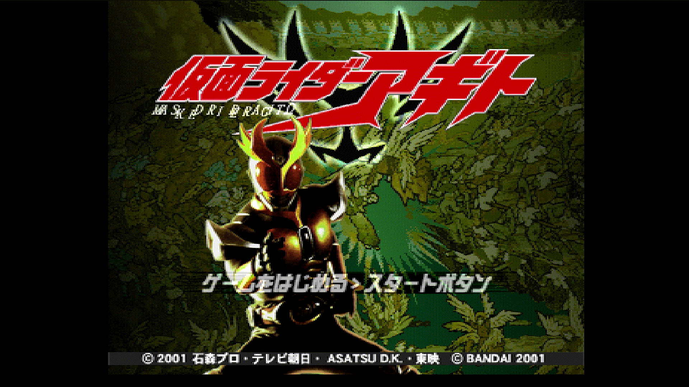
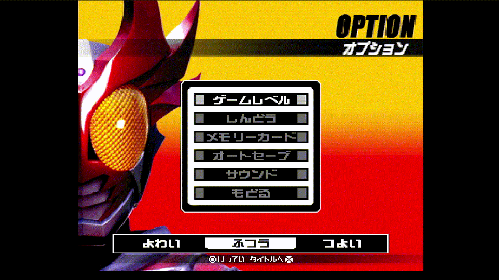
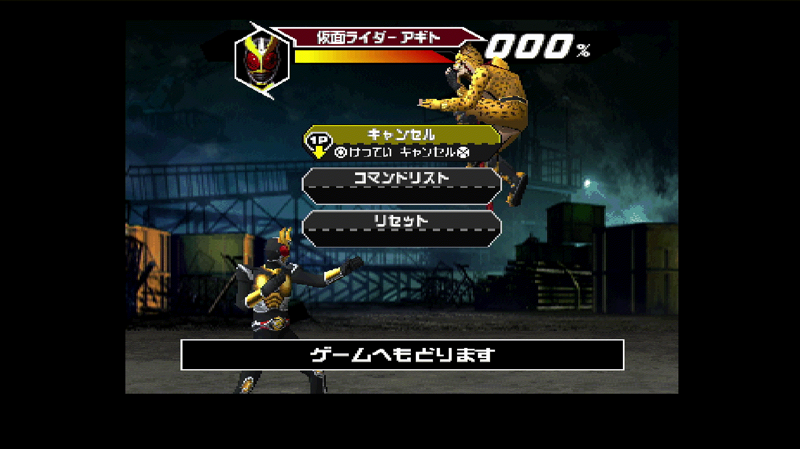
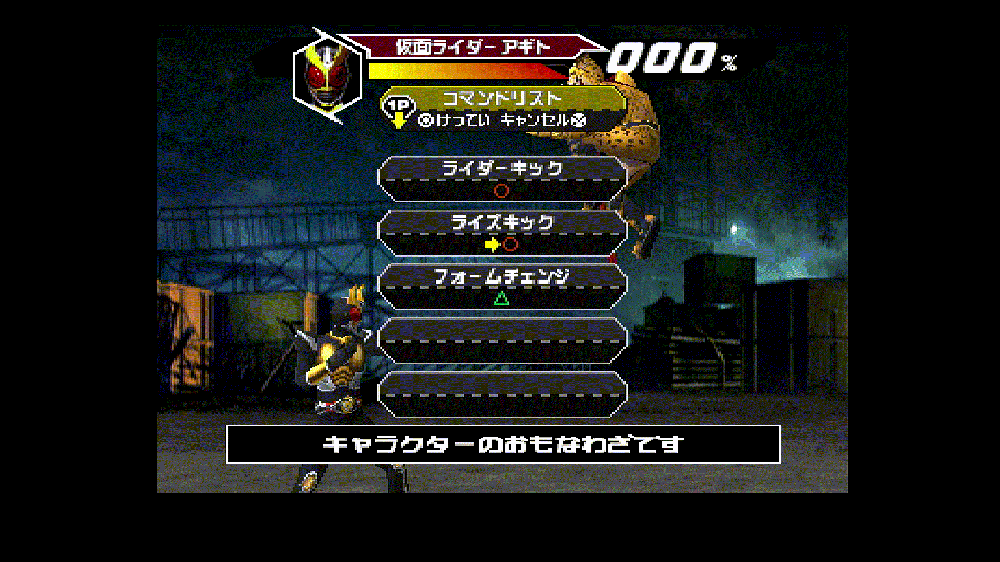
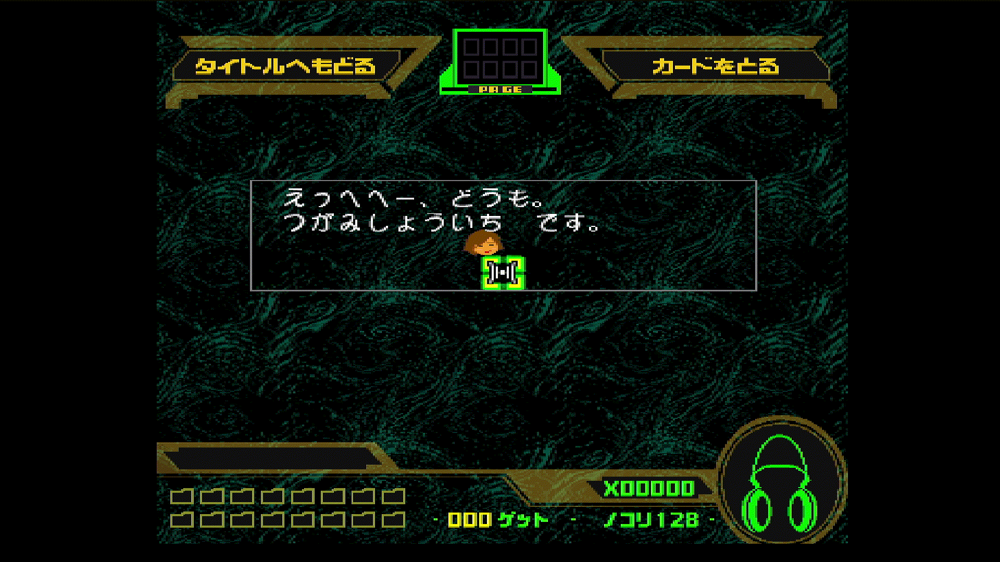

# [PS1] Kamen Rider Agito (Japan) — AI English Translation Patch

Fan translation of **Kamen Rider Agito** (仮面ライダーアギト), released by Bandai for the PlayStation in Japan in 2001 (**SLPS-03344**).

> This is an unofficial fan project. It is not affiliated with Bandai, Toei, Ishimori Pro, TV Asahi or ADK. **No game data is distributed here.** You need your own copy of the original Japanese game.



## Available patches

| Patch                                                            | Language | Notes            |
| ---------------------------------------------------------------- | -------- | ---------------- |
| `Kamen Rider Agito (Japan) - AI English Translation v1.0.xdelta` | English  | Full translation |

## What is translated

- **Menus:** title menu, options (including the OPTION title), pause menu and the footers of every screen.
- **Single-player (Agito) mode:** tutorial prompts, stage/episode texts and the GAME BULLET screen.
- **Player select:** character names, the strength/handicap panel, the background "PLAYER SELECT" art and the win counter.
- **Versus mode:** handicap screen, in-battle menus and the WINNER / CONTINUE effects.
- **Move lists:** all characters. Attack names are kept as in the original (Rider Kick, Flame Cutter…), as they are official names.
- **G-Trailer:** G3 unit customization, unit name editor, level-up texts and the LEVEL label.
- **Gallery (Character Get):**
  - Tsugami and Hikawa dialogues.
  - All 128 card descriptions.
  - Buttons, titles, the PAGE label, the card counter and the loading screen.
- **Memory Card Battle:** instructions and every post-battle comment.
- **Memory card:** all messages and the save title.
- **Opening video:** subtitles for the theme song.
- **Notice screen:** a short screen about the use of AI, shown for 5 seconds before the Bandai logo.
- **Credit:** a translation credit line on the title screen.

## What is NOT translated

- **Ending credits video:** the staff names are part of the video itself.
- **Voices and songs:** the audio is unchanged.
- **Character and attack names:** kept as the official names used by the series.

## Extra: GunCon support in the Gallery

In the Gallery (Character Get), you can aim with a **Namco GunCon** connected to **port 1 or port 2**. The crosshair follows the gun directly; the trigger works as ○, button B as × and button A as START. Without a GunCon, nothing changes.

- To leave the Gallery with the gun, shoot "BACK TO TITLE" on screen. Page switching still uses L/R on a controller.
- In DuckStation, set a **GunCon** in **Settings → Controllers**; the mouse acts as the gun.
- On real hardware, the GunCon only works on a **CRT TV**.

---

## What you need

1. **The original Japanese game as a single BIN/CUE**, in the Redump format: `Kamen Rider Agito (Japan).bin` + `.cue`, MODE2/2352, one track.

   Check that your `.bin` matches **before** patching:

   |       | Value                                      |
   | ----- | ------------------------------------------ |
   | Size  | 202,996,416 bytes                          |
   | CRC32 | `77DF142E`                                 |
   | MD5   | `ccdc7dfd1f6fdbb8042a2137807e01f6`         |
   | SHA-1 | `89c9ce576b5575293b253638776222652b91a80a` |

   If your dump is in another format (CHD, ISO, multiple files), convert it to a single `.bin` + `.cue` first. For CHD, `chdman extractcd` does this.

2. **The patch file** (`.xdelta`) from the Releases page.

3. **An xdelta patcher.** Any of these works:
   - **Rom Patcher JS** (online, any OS): https://www.marcrobledo.com/RomPatcher.js/
   - **Delta Patcher** (Windows / Linux)
   - **xdelta UI** (Windows)
   - **xdelta3** (command line, any OS)

---

## How to install

The examples use the English patch.

### Option A — Rom Patcher JS (easiest)

1. Open Rom Patcher JS in your browser.
2. **ROM file:** select `Kamen Rider Agito (Japan).bin`.
3. **Patch file:** select the `.xdelta` patch.
4. Click **Apply patch** and save the result, for example as `Kamen Rider Agito (English).bin`.

The patches are about 19 MB, so applying them in the browser can take a little while.

### Option B — Delta Patcher / xdelta UI

1. **Original file:** `Kamen Rider Agito (Japan).bin`.
2. **Patch file:** the `.xdelta`.
3. **Output file:** `Kamen Rider Agito (English).bin`.
4. Click **Apply patch** (or **Patch**).

### Option C — command line

```
xdelta3 -d -s "Kamen Rider Agito (Japan).bin" "Kamen Rider Agito (Japan) - AI English Translation v1.0.xdelta" "Kamen Rider Agito (English).bin"
```

### Create the .cue file

The patched `.bin` needs its own `.cue`.

1. Create a text file named `Kamen Rider Agito (English).cue`, next to the `.bin`, with this content:

   ```
   FILE "Kamen Rider Agito (English).bin" BINARY
     TRACK 01 MODE2/2352
       INDEX 01 00:00:00
   ```

2. The name inside the quotes must match your `.bin` file name exactly.

Open the `.cue` in your emulator.

**Expected checksums of the patched `.bin`:**

| Patch                                                          | CRC32      | SHA-1                                      |
| -------------------------------------------------------------- | ---------- | ------------------------------------------ |
| Kamen Rider Agito (Japan) - AI English Translation v1.0.xdelta | `3BD2C218` | `89d677c18defee23d43fa13f3a050121a5187a47` |

---

## Playing

**Emulators:** DuckStation is recommended. Any accurate PS1 emulator should work, such as Beetle PSX or PCSX-Redux.

**Real hardware:** the patch was tested on a real PlayStation with PicoStation, XStation and burnt CD on PlayStation 2. Use an ODE (XStation, PSIO…) or burn the `.bin`/`.cue` to a CD-R for a modded console. The patch keeps the disc's error-correction data (EDC/ECC) valid.

**Memory Card Battle:** needs **two memory cards**, one in each slot, each with a save that has a G3 unit. In DuckStation, set up a card for port 2 in **Settings → Memory Cards**.

**Old saves:** saves made with the Japanese version still work. Their title on the memory card screen only changes after you save again with the patched game.

---

## About the use of AI in this project

This translation was made **with the help of an AI**: Claude, by Anthropic, working together with a human.

**Done by the AI:**

- Reverse engineering of the game: file formats, text encoding, compression, pointers, the text engine.
- Writing the extraction, insertion and build tools, the notice screen and the GunCon support.
- The English translation of the texts.
- Redrawing the graphics with translated text.

**Done by the human (IMPHOSTIL):**

- Directed the project and decided what to translate and how.
- Wrote the opening subtitles and designed the notice screen.
- Tested every screen on an emulator and on real hardware, reported every bug with screenshots and reviewed the results.

Because of this, some translations may not be perfect. Several texts also had to be **shortened** to fit the fixed space the game has for them, which applies especially to the Gallery and the Memory Card Battle comments. Corrections and suggestions are welcome; please open an _Issue_.

The full process is documented, so anyone can reproduce or continue the work without AI.

---

## Support the human romhackers

This translation was made with the help of AI. It was not made by a traditional translation team.

Please support the fan translation groups and romhackers who do this work by hand. They spend months, often years, on reverse engineering, translating, redrawing graphics and testing, with no AI and no pay, purely out of love for these games. Their work made projects like this one possible. Follow them, credit them, and thank them.

## Some images...









## This patch is free

**This patch is free and will always be free.** It was made by fans, for fans. Do not sell this patch, pre-patched copies of the game, or physical discs that include it. If you paid for it, you were scammed.

This is an unofficial fan project with no affiliation with the rights holders.

---

## Credits

|                                                       |                                                                    |
| ----------------------------------------------------- | ------------------------------------------------------------------ |
| Project, testing, opening subtitles and notice screen | **IMPHOSTIL** - https://www.youtube.com/@imphostil                 |
| Reverse engineering, tools and translation            | Claude (Anthropic), under human direction                          |
| Original game                                         | © 2001 Ishimori Pro · TV Asahi · Asatsu D.K. · Toei, © Bandai 2001 |

Please support the official releases of the Kamen Rider franchise.
